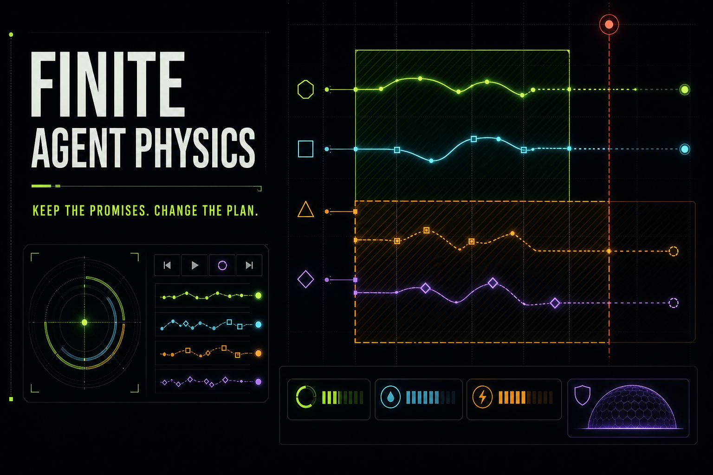
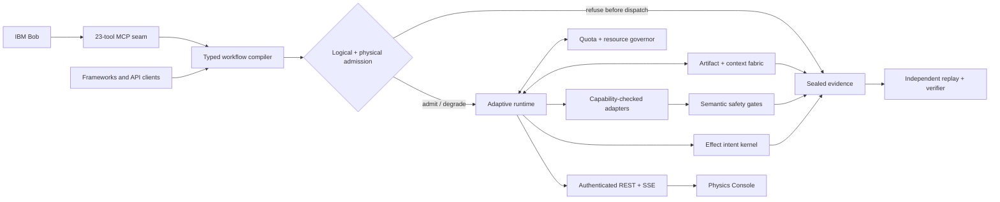

# FINITE / Agent Physics



> Agents can reason. FINITE makes them keep promises.

FINITE is an experimental runtime that holds AI agent workflows to the limits they are given:
deadlines, token and cost budgets, provider rate limits, machine resources, and rules about
real-world side effects. It checks whether a workflow can meet its limits before any model is
called, refuses work that cannot, replans when conditions change mid-run, and records enough
evidence to replay and verify each run afterwards.

**Status:** experimental release candidate (`5.0.0rc1`). Python 3.11+, 1,020 tests, Apache-2.0.
It is not a production control plane; the boundaries are listed in
[docs/limitations.md](docs/limitations.md).

## The problem

Graph libraries express what may happen next. They do not make deadlines, provider queues,
token and cost ceilings, context movement, machine capacity, retries, or consequential actions
disappear. Under pressure, a workflow can finish late, silently weaken required work, overspend,
amplify a provider failure, or repeat an unsafe write.

FINITE treats those limits as part of the program. The name "Agent Physics" refers to the
lower bound every run is checked against:

```text
runtime >= max(critical-path latency, total work / available capacity, required transport + RTT)
```

## What it does

- **Compiles workflows into typed contracts.** Python, JSON and YAML definitions reduce to one
  canonical form. Unknown fields, duplicate keys, dependency cycles and mismatched task inputs
  and outputs are rejected before anything runs.
- **Admits or refuses before dispatch.** Each run is checked against its deadline, token, cost
  and context budgets and against declared CPU, memory, storage and network capacity. A run that
  cannot fit is refused with zero provider calls.
- **Accounts in integers.** Budgets, provider concurrency and rate limits are tracked in integer
  ledgers that an independent replay re-derives, so usage cannot be hidden or double-counted.
- **Replans without losing work.** When a provider rate-limits, capacity drops or a budget is
  cut, the runtime re-solves the remaining plan, sheds optional tasks first and keeps everything
  already settled.
- **Guards side effects.** Workers cannot write to the outside world directly. Declared writes
  become durable intents that need an exact-scope approval, carry idempotency keys and survive
  crashes without being applied twice.
- **Leaves verifiable evidence.** Every run produces an append-only event log. A separate
  verifier replays it from sealed evidence without calling a provider, and rejects tampered
  records.

The full list is in [docs/proof-points.md](docs/proof-points.md). Each item is implemented and
tested locally inside a stated boundary; none is a claim of production readiness.

## Architecture



A model may propose a graph, a result or an action. Only typed validation, admission, resource
settlement, safety gates, approval and durable state can authorize progress. See
[docs/architecture.md](docs/architecture.md) and [docs/effect-kernel.md](docs/effect-kernel.md).

## Quick start

```bash
python -m pip install -e ".[dev,api,langgraph]"
python -m pytest
agent-physics demo --policy adaptive
```

The demo schedules a fictional emergency-operations workflow on simulated backends. No model or
external service is called.

```text
Agent Physics - Miami EOC pressure test
policy:          adaptive
success:         True
makespan:        6180 ms
model bound:     6180 ms
model-bound gap: 1.0x
tokens:          6480
cost:            5750 micro-USD
```

`--policy sequential` runs the same tasks one after another and finishes in 8880 ms, 1.44 times
the model bound. `agent-physics preflight` prints the admission certificate with each limit
and the value observed against it.

## Interfaces

| Interface | Command or path | Notes |
|---|---|---|
| CLI | `agent-physics` | Demo, preflight, benchmark and evidence commands |
| HTTP API | `finite-api` | Bearer-authenticated REST with a resumable server-sent event stream |
| MCP server | `finite-mcp` | 23 tools over STDIO, built for IBM Bob ([guide](docs/bob-mcp.md)) |
| Web console | `apps/physics-console` | Next.js app that replays a sealed run or drives a live one |
| Adapters | `.[langgraph]`, `.[watsonx]` | LangGraph conformance comparator; optional watsonx.ai / Granite executor |

To run the API with the console:

```bash
export FINITE_CONTROL_BEARER_TOKEN="replace-with-at-least-32-random-characters"
export FINITE_CONTROL_ALLOWED_ORIGINS="http://localhost:3000"
finite-api --host 127.0.0.1 --port 8080

# in a second terminal
cd apps/physics-console && npm ci && npm run dev
```

`docker compose up --build` starts the same API in a non-root, read-only container bound to
loopback. It requires the same bearer token.

## Reproducing the evidence

```bash
agent-physics fair-benchmark --output artifacts/fair-benchmark
agent-physics production-survival --trials 10 --output artifacts/production-survival
agent-physics production-survival --verify-only artifacts/production-survival
python scripts/run_live_load.py --output artifacts/live-load
python scripts/run_live_load.py --verify-only artifacts/live-load
```

- [Production survival](docs/production-survival.md): crash, restart and recovery drills that
  check for repeated work and duplicate effects.
- [Live-load proof](docs/live-load-proof.md): 64 runs submitted over real local sockets, each paused, disturbed and resumed.
- [LangGraph comparator](docs/langgraph-baseline.md): the same workflow on LangGraph 1.2.9. This
  is a conformance control, not a speed comparison.
- [Benchmark protocol](docs/BENCHMARK.md): the preregistered comparison design.

CI runs the suite on Python 3.11 to 3.13 with statement and branch coverage floors of 90% and
80%, and fails on any skipped test.

## Documentation

| Document | Contents |
|---|---|
| [docs/architecture.md](docs/architecture.md) | Design invariants and the planes of the runtime |
| [docs/effect-kernel.md](docs/effect-kernel.md) | Approval, fencing, idempotency and crash recovery for side effects |
| [docs/limitations.md](docs/limitations.md) | What is simulated, estimated or not supported |
| [docs/capability-status.md](docs/capability-status.md) | Audit of all 62 acceptance gates in [docs/PROGRAM.md](docs/PROGRAM.md) |
| [docs/bob-mcp.md](docs/bob-mcp.md), [docs/watsonx-adapter.md](docs/watsonx-adapter.md) | IBM Bob and watsonx.ai integration |
| [docs/ibm-offline-certification.md](docs/ibm-offline-certification.md) | Credential-free contract tests against the IBM SDK |
| [docs/competitive-landscape.md](docs/competitive-landscape.md) | How FINITE relates to LangGraph, AutoGen, CrewAI and others (July 2026 snapshot) |

## Background

FINITE started as an entry for the July 2026 AI Builders Challenge with IBM Bob. The entry was
not submitted. The IBM Bob MCP integration and the watsonx.ai adapter come from that work, and
the planning and submission documents are kept in
[docs/archive/ibm-bob-challenge-2026-07](docs/archive/ibm-bob-challenge-2026-07/README.md).

The watsonx.ai adapter has been tested against the IBM SDK's request builder and response parser
with networking blocked. It has not been run against a live Granite model.

## Safety boundary

The demo workload, StormShift, is fictional. No code in this repository publishes an emergency
alert or contacts an emergency service or any public audience. High-risk writes stop at a
proposed intent unless a separately configured simulation target receives an exact approval. Do
not connect FINITE to a real consequential system without a new threat model, production IAM,
isolation, a retention policy, an operational review, and target-side idempotency evidence.

## License

Apache-2.0. See [LICENSE](LICENSE).
